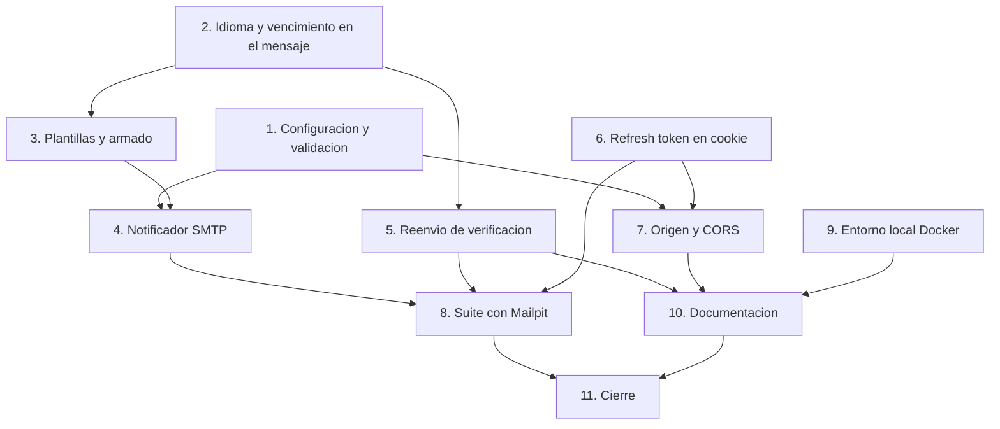

# Implementation Plan

> Envío de correos y sesión segura para el cliente web de MiSaldo.

## Overview

Se construye en este orden:
1. La configuración y su validación al arrancar (1).
2. El mensaje con idioma y las plantillas (2–3).
3. El notificador SMTP (4) y el reenvío de verificación (5).
4. La sesión por cookie (6), con su protección y CORS (7).
5. La suite con Mailpit real (8).
6. El entorno local (9) y la documentación (10).
7. El cierre (11).

Cada tarea es pequeña y verificable; márcala completa solo cuando compila y sus
pruebas pasan. Las tareas marcadas con 🐳 necesitan **Docker corriendo**
(Testcontainers con PostgreSQL y Mailpit reales).

## Tasks

- [x] 1. Configuración y validación al arrancar
  - Agregar `SmtpOptions`, `FrontendOptions` y la lectura de
    `Cors:AllowedOrigins`, con su validación: modo de seguridad, remitente y URL
    del frontend obligatorios si hay servidor SMTP, `None` prohibido en
    Production, orígenes sin comodín, solo `http`/`https` y sin ruta.
  - En Production, la API no arranca sin SMTP válido; el mensaje nombra la clave
    sin mostrar valores.
  - Pruebas: cada regla de validación; Production sin SMTP y con comodín no
    arranca; Development sin SMTP sí.
  - _Requisitos: R1.2–R1.5, R7.2, R7.4, R10.5_

- [x] 2. Idioma y vencimiento en el mensaje de cuenta
  - Agregar `Language` y `ExpiresAt` a `AccountTokenMessage` y llenarlos en el
    registro y en la recuperación.
  - Aceptar `language` opcional (`es`/`en`, por defecto `es`) en el registro,
    validarlo y guardarlo en la configuración del usuario.
  - Pruebas: el registro guarda el idioma; un idioma no soportado da 400; el
    mensaje lleva idioma y vencimiento.
  - _Requisitos: R2.3_

- [x] 3. Plantillas y armado de los correos
  - Plantillas incrustadas de verificación y recuperación, en español e inglés,
    en texto y HTML; `AccountEmailComposer` arma asunto, texto y HTML con el
    enlace `{Frontend:BaseUrl}/verify-email?token=` o `/reset-password?token=` y
    la vigencia.
  - Pruebas: idioma correcto; enlace bien formado con el token codificado;
    valores codificados en el HTML; el correo de recuperación avisa que se puede
    ignorar; ningún correo lleva datos financieros.
  - _Requisitos: R2.1, R2.2, R2.4–R2.6_

- [x] 4. Notificador SMTP
  - Agregar MailKit y `SmtpAccountNotifier`: envío con el modo de seguridad
    configurado, credenciales opcionales y tiempo máximo; ante un fallo registra
    un `Warning` sin token, enlace ni contraseña, y no lanza.
  - Seleccionar el notificador al arrancar (SMTP si hay servidor; en memoria
    solo en Development o pruebas).
  - Agregar `MailpitFixture` (Testcontainers, `axllent/mailpit`) con un cliente
    de su API HTTP.
  - Pruebas 🐳: un correo enviado llega a Mailpit con el remitente, el asunto y
    el enlace; con el servidor caído no lanza y registra el fallo sin secretos.
  - _Requisitos: R1.1, R1.6, R3.1–R3.3_

- [x] 5. Reenvío del correo de verificación
  - `ListUsableOneTimeTokensAsync` en el repositorio, `ResendVerificationHandler`
    y `POST /auth/resend-verification` (siempre 202, bajo el límite de
    `/auth/*`).
  - Con cuenta existente y no verificada, consume los tokens vigentes y emite
    uno nuevo; si el último tiene menos de 60 s, no hace nada.
  - Pruebas 🐳: el enlace anterior deja de servir y el nuevo verifica; la
    respuesta es igual para correo inexistente, ya verificado o en espera.
  - _Requisitos: R4.1–R4.5_

- [ ] 6. Refresh token en cookie
  - `RefreshCookie` (`__Secure-misaldo-refresh`, `HttpOnly`, `Secure`,
    `SameSite=Strict`, `Path=/api/v1/auth`) y `SessionResponse` sin el refresh
    token.
  - Login y refresh escriben la cookie; refresh y logout la leen; se borra en el
    logout, en un refresh fallido y en el restablecimiento de contraseña.
  - Ajustar `ApiTestHost` y las pruebas existentes al cliente con
    `https://localhost` y a la sesión por cookie.
  - Pruebas 🐳: atributos de la cookie; el cuerpo no trae el refresh token;
    login → refresh → logout solo con la cookie; reutilización rechazada y
    cookie borrada.
  - _Requisitos: R5.1–R5.6, R6.3, R10.3, R10.6_

- [ ] 7. Protección de origen y CORS
  - `SameOriginGuard` en refresh y logout (403 `auth.origin_not_allowed` con un
    `Origin` ajeno; sin `Origin` se acepta).
  - Política CORS con los orígenes configurados, credenciales, métodos y
    cabeceras permitidos, cabeceras expuestas y caché del preflight; ubicada
    antes de la autenticación en el pipeline.
  - Pruebas 🐳: preflight y petición de un origen permitido reciben las
    cabeceras; uno no permitido no; refresh con `Origin` ajeno responde 403 y la
    sesión sigue válida.
  - _Requisitos: R6.1, R6.2, R7.1, R7.3–R7.5, R10.4_

- [ ] 8. 🐳 Suite de extremo a extremo con Mailpit
  - El registro en español envía el correo; la prueba lo lee de Mailpit, sigue
    el enlace y la cuenta queda verificada.
  - El registro en inglés y la recuperación en inglés envían los correos en
    inglés; la recuperación completa cambia la contraseña.
  - Con el servidor SMTP caído, el registro responde 201 y el reenvío funciona
    cuando vuelve.
  - Extender la prueba de logs sin secretos al envío real (token, enlace y
    contraseña SMTP no aparecen).
  - _Requisitos: R10.1, R10.2, R10.6, R1.6, R3.1_

- [ ] 9. Entorno local con Docker Compose
  - `docker-compose.dev.yml` con PostgreSQL (`postgres:17-alpine`, volumen),
    Mailpit y pgAdmin (volumen, `servers.json` con la conexión de
    administración), `restart: unless-stopped` y puertos solo en `127.0.0.1`.
  - `deploy/dev/postgres-init/01-app-role.sh`: crea `misaldo_app` sin
    `BYPASSRLS`, con permisos por defecto sobre las tablas de las migraciones.
  - Las contraseñas vienen del `.env` local; nada escrito en el Compose.
  - Verificación manual: levantar, aplicar las migraciones como administrador,
    arrancar la API contra la base y completar registro y verificación con
    Mailpit; comprobar que `misaldo_app` no ve filas sin `app.user_id` y que los
    datos siguen tras reiniciar los contenedores.
  - _Requisitos: R8.1–R8.3, R8.5–R8.8_

- [ ] 10. Documentación y configuración
  - `.env.example`: SMTP, URL del frontend, orígenes CORS, variables del entorno
    local y la clave JWT fija.
  - README:
    - Levantar el entorno, aplicar las migraciones, cargar el `.env` y ejecutar
      la API.
    - Ver los correos en Mailpit.
    - Pasar a un Gmail dedicado y, en producción, a un proveedor transaccional.
    - Conectarse en pgAdmin como administrador o ver la base como un usuario
      con `SET app.user_id`, y el aviso sobre editar a mano.
    - Respaldar y restaurar con `pg_dump`, y el aviso sobre
      `docker compose down -v`.
    - Corregir la sugerencia de generar la clave JWT en cada arranque.
  - OpenAPI: el endpoint de reenvío y la cookie de refresh documentados.
  - _Requisitos: R8.4, R8.9, R8.10, R9.1–R9.3_

- [ ] 11. Cierre
  - Verificar la suite completa (dominio, aplicación, infraestructura y API) en
    verde.
  - Confirmar que no quedan secretos en el repositorio ni en los logs.
  - Registrar en el SRS el cambio de contrato del refresh token (cookie) en el
    control de cambios.
  - _Requisitos: R10.6, R9.1_

## Task Dependency Graph

```json
{
  "waves": [
    { "id": 0, "tasks": ["1", "2", "6", "9"] },
    { "id": 1, "tasks": ["3", "5", "7"] },
    { "id": 2, "tasks": ["4"] },
    { "id": 3, "tasks": ["8", "10"] },
    { "id": 4, "tasks": ["11"] }
  ]
}
```



## Notes

- **Cambio de contrato:** el refresh token deja de viajar en el cuerpo. No hay
  clientes todavía, así que no rompe a nadie; la app móvil (F4) tendrá su propio
  modo de sesión con almacenamiento seguro.
- **Cookies `Secure` en pruebas:** el cliente de pruebas usa
  `https://localhost`, porque las cookies `Secure` no viajan por `http`. Los
  navegadores sí las aceptan en `http://localhost` durante el desarrollo.
- **Sin dominio todavía:** SPF, DKIM y DMARC se configuran al preparar el
  despliegue a producción (D-13); este spec solo deja lista la configuración.
- **Docker:** las tareas 🐳 y la verificación del entorno local requieren el
  engine corriendo. Las tareas 1, 2 y 3 se prueban sin Docker.
