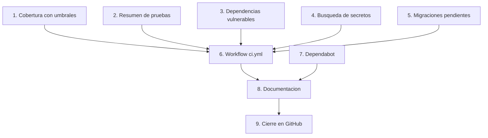

# Implementation Plan

> Integración continua de MiSaldo.

## Overview

Se construye en este orden:
1. Cada revisión en local, con su script y una prueba de que falla cuando debe:
   - cobertura (1);
   - resumen de pruebas (2);
   - dependencias vulnerables (3);
   - secretos (4);
   - migraciones pendientes (5).
2. El workflow que las une (6) y Dependabot (7).
3. La documentación (8).
4. El cierre en GitHub (9).

Cada tarea es pequeña y verificable; márcala completa solo cuando funciona en
local. Las tareas marcadas con 🐳 necesitan **Docker corriendo**. La tarea 9
necesita que el usuario haga **push** a `dev`.

## Tasks

- [x] 1. 🐳 Cobertura con umbrales
  - Agregar `coverage.runsettings` (Domain y Application, formato Cobertura) y
    `dotnet-reportgenerator-globaltool` fijado en `dotnet-tools.json`.
  - `scripts/ci/Test-Coverage.ps1`: lee `Summary.json` y compara cada
    ensamblado con su mínimo (90 % Domain, 70 % Application por defecto);
    imprime el valor medido y falla por debajo.
  - Medir la línea base con toda la suite. **Si Domain queda bajo 90 % o
    Application bajo 70 %, parar y acordar con el usuario** qué pruebas agregar
    antes de activar el umbral.
  - Verificación: el script pasa con la cobertura real y falla con un mínimo
    mayor que el medido.
  - _Requisitos: R2.1–R2.3_

- [x] 2. Resumen de las pruebas
  - `scripts/ci/Write-TestSummary.ps1`: totales por proyecto desde los `.trx` y
    cada prueba fallida con la primera línea de su mensaje; escribe en
    `$GITHUB_STEP_SUMMARY` si existe y en la consola siempre.
  - Verificación: con los `.trx` reales y con uno preparado que tenga una prueba
    fallida, que debe aparecer por nombre.
  - _Requisitos: R1.5_

- [x] 3. Dependencias vulnerables
  - `Directory.Build.props`: `NuGetAuditMode=all`, `NuGetAuditLevel=low` y
    `WarningsNotAsErrors` con `NU1901;NU1902`. Alta y crítica siguen fallando el
    restore; baja y moderada pasan a ser solo avisos.
  - `scripts/ci/Test-VulnerablePackages.ps1`: ejecuta
    `dotnet list package --vulnerable --include-transitive --format json`,
    escribe la tabla (paquete, versión, severidad, aviso) y falla con High o
    Critical.
  - Verificación: el repositorio actual pasa; una salida JSON preparada con una
    vulnerabilidad alta falla y con una moderada solo avisa.
  - _Requisitos: R3.1, R3.2_

- [x] 4. 🐳 Búsqueda de secretos
  - `.gitleaks.toml`: reglas por defecto y excepciones por valor, cada una
    comentada (los `change_me_*` de `.env.example` y las contraseñas fijas de
    los contenedores de prueba).
  - Ejecutar gitleaks (imagen oficial fijada por digest) sobre todo el
    historial con `--redact`. **Si aparece un secreto real, parar y avisar al
    usuario:** limpiar el historial es una decisión suya.
  - Verificación: el historial actual pasa; una carpeta temporal con un secreto
    falso se detecta y la salida no muestra el valor.
  - _Requisitos: R4.1–R4.3_

- [x] 5. Migraciones pendientes
  - Comando `dotnet ef migrations has-pending-model-changes` con la herramienta
    local y el `DesignTimeDbContextFactory` existente.
  - Verificación: pasa con el modelo actual y falla con un cambio de modelo
    temporal sin migración, que después se revierte.
  - _Requisitos: R5.1, R5.2_

- [x] 6. Workflow `ci.yml`
  - Trabajos `build-and-test`, `dependencies` y `secrets`, según el diseño:
    - disparadores `push` y `pull_request` a `dev` y `main`;
    - `permissions: contents: read`, `concurrency` y `timeout-minutes`;
    - SDK desde `global.json` y caché de NuGet;
    - compilación Release y pruebas con `--no-build`;
    - resumen y artefactos con `if: always()`.
  - Fijar `actions/checkout`, `actions/setup-dotnet`, `actions/cache` y
    `actions/upload-artifact` al SHA de su última versión estable, con la
    versión en comentario.
  - Verificación: `actionlint` (imagen oficial fijada) sin errores; cada paso usa
    los scripts ya probados en las tareas 1 a 5.
  - _Requisitos: R1.1–R1.6, R6.1–R6.3_

- [ ] 7. Dependabot
  - `.github/dependabot.yml`: `nuget` y `github-actions`, semanal, hacia `dev`,
    con grupos (EF Core, ASP.NET Core, xUnit, Testcontainers).
  - Verificación: el archivo valida contra el esquema de Dependabot.
  - _Requisitos: R3.3_

- [ ] 8. Documentación
  - README:
    - insignia del workflow y qué revisa cada trabajo;
    - cómo ejecutar en local cada revisión: pruebas, cobertura, dependencias
      vulnerables, secretos y migraciones pendientes;
    - cómo agregar una excepción de secretos y cuándo no hacerlo;
    - pasos para proteger `main` con un ruleset que exija los tres trabajos;
    - pasos para activar las alertas y las actualizaciones de seguridad de
      Dependabot.
  - _Requisitos: R7.1–R7.3_

- [ ] 9. Cierre en GitHub
  - El usuario hace push a `dev`. Comprobar en GitHub:
    - los tres trabajos en verde;
    - el resumen de pruebas y de cobertura visible;
    - los artefactos publicados;
    - el tiempo total razonable gracias a la caché (segunda corrida).
  - Verificar la suite completa en local en verde.
  - _Requisitos: R1–R7_

## Task Dependency Graph

```json
{
  "waves": [
    { "id": 0, "tasks": ["1", "2", "3", "4", "5", "7"] },
    { "id": 1, "tasks": ["6"] },
    { "id": 2, "tasks": ["8"] },
    { "id": 3, "tasks": ["9"] }
  ]
}
```



## Notes

- **Sin push desde el agente:** el pipeline solo se ve corriendo cuando el
  usuario sube los cambios. Todo lo anterior se verifica en local.
- **Pasos manuales en GitHub:** proteger `main` y activar las alertas y
  actualizaciones de seguridad de Dependabot necesitan permisos de
  administrador del repositorio; el README los explica paso a paso.
- **Cambio de comportamiento local:** después de la tarea 3, una vulnerabilidad
  baja o moderada ya no rompe la compilación en el equipo de desarrollo; solo
  avisa. Alta y crítica siguen rompiéndola.
- **Fuera de alcance:** despliegue automático y trabajos del frontend (spec 08).
