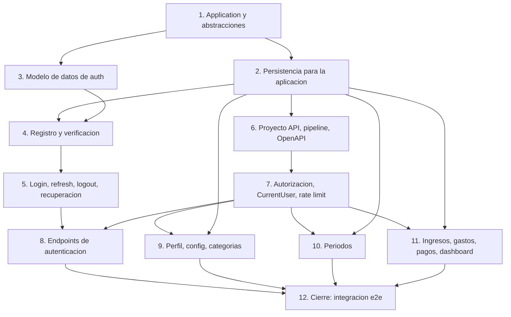

# Implementation Plan

> API REST y autenticación propia (JWT) de MiSaldo.

## Overview

Se construye de adentro hacia afuera: primero la capa de aplicación y sus
abstracciones (1–2), luego la autenticación propia con su modelo de datos (3–5),
después la API y su seguridad transversal (6–7), los endpoints de F1 (8–11) y el
cierre con las pruebas de integración de extremo a extremo (12).

Cada tarea es pequeña y verificable; márcala completa solo cuando compila y sus
pruebas pasan. Las tareas marcadas con 🐳 necesitan **Docker corriendo** porque
usan Testcontainers (PostgreSQL real) con `WebApplicationFactory`.

## Tasks

- [x] 1. Capa de aplicación y abstracciones
  - Crear `src/MiSaldo.Application` (net10.0, ref a Domain, sin ASP.NET/EF).
  - Definir las abstracciones: `IUnitOfWork`, repositorios, `IClock`,
    `ITokenService`, `IPasswordHasher`, `ICurrentUser` (reusar el de infra), y el
    tipo `Result`/errores de aplicación.
  - Verificar con `dotnet build` y una prueba de un caso de uso trivial.
  - _Requisitos: R1.1, R1.2_

- [x] 2. Implementación de persistencia para la aplicación
  - Implementar en `MiSaldo.Infrastructure` los repositorios y `IUnitOfWork`
    sobre `MiSaldoDbContext`; registrar en DI.
  - Pruebas (🐳 reusan el fixture de persistencia): un repositorio guarda y lee.
  - _Requisitos: R1.3_

- [x] 3. Modelo de datos de autenticación
  - Agregar `UserCredential`, `RefreshToken`, `OneTimeToken` (persistencia) y su
    migración; `IPasswordHasher` con Argon2id y `ITokenService` con JWT HS256.
  - Pruebas: hash verifica/rechaza; el token se firma y valida con claims `sub`.
  - _Requisitos: R2.5, R4.2, R4.3, R5.4_

- [x] 4. Registro y verificación de correo
  - [x] 4.1 Caso de uso de registro: valida edad (+18), política de contraseña,
        correo único; crea User/Profile/Settings/Consent/Credential y categorías
        iniciales en una transacción.
    - Pruebas (🐳): registro válido crea todo; menor de 18 rechazado (CP-11);
      correo duplicado y contraseña corta rechazados.
    - _Requisitos: R2.1–R2.5, R9.1_
  - [x] 4.2 Verificación de correo: genera y consume el token de un solo uso.
    - Pruebas: token válido marca verificado; token consumido o expirado falla.
    - _Requisitos: R3.1–R3.4_

- [x] 5. Login, refresh, logout y recuperación
  - [x] 5.1 Login: verifica hash, emite access + refresh, cuenta intentos y
        bloquea; error genérico en credenciales inválidas.
    - Pruebas: login válido emite tokens; inválido da error genérico; bloqueo
      tras N intentos.
    - _Requisitos: R4.1, R4.4, R4.5_
  - [x] 5.2 Refresh y logout: rotación del refresh token, revocación en logout,
        rechazo de token ya usado.
    - Pruebas: refresh rota y el viejo falla; logout invalida.
    - _Requisitos: R5.1–R5.4_
  - [x] 5.3 Recuperación de contraseña: token de reset, respuesta uniforme,
        reseteo que revoca sesiones.
    - Pruebas: respuesta igual exista o no el correo; reset cambia hash e
      invalida sesiones.
    - _Requisitos: R6.1–R6.3_

- [x] 6. Proyecto API, pipeline y OpenAPI
  - Crear `src/MiSaldo.Api` (net10.0, ref a Application e Infrastructure);
    configurar DI, JWT bearer, Problem Details, correlación, OpenAPI y `/api/v1`.
  - Verificar con `dotnet build` y el arranque de la app en una prueba de humo.
  - _Requisitos: R14.1, R14.3, R14.4_

- [x] 7. Autorización, CurrentUser y rate limiting
  - Middleware que puebla `ICurrentUser` desde el claim `sub`; rutas privadas
    exigen token (401 sin él); rate limiting con política estricta en `/auth/*`.
  - Pruebas (🐳): ruta privada sin token → 401; con token resuelve el usuario.
  - _Requisitos: R7.1, R7.2, R7.4, R7.5_

- [x] 8. Endpoints de autenticación
  - Controlador `/auth`: register, verify-email, login, refresh, logout,
    forgot-password, reset-password, conectados a los casos de uso.
  - Pruebas (🐳): flujo registro → verificación → login → refresh → logout.
  - _Requisitos: R2, R3, R4, R5, R6, R15.2_

- [x] 9. Perfil, configuración y categorías
  - Controladores `/profile`, `/settings`, `/categories` con sus casos de uso;
    bloqueo de cambio de moneda con movimientos; categoría única por usuario.
  - Pruebas (🐳): leer/editar perfil; config persiste; categoría duplicada → 409.
  - _Requisitos: R8.1–R8.3, R9.2–R9.4_

- [ ] 10. Periodos
  - Controlador `/periods`: crear (explícito, no automático), estado, cierre con
    arrastre, rechazo de solapamiento y exigencia de cerrar vencidos.
  - Pruebas (🐳): creación explícita (CP-20); solapamiento → 409; cierre con
    arrastre (CP-14); vencido bloquea el siguiente (CP-21).
  - _Requisitos: R10.1–R10.4_

- [ ] 11. Ingresos, gastos, pagos y dashboard
  - [ ] 11.1 `/incomes` y `/expenses` (+ `/expenses/{id}/payments`): CRUD,
        marcar recibido, pagos con clave de idempotencia, estado derivado.
    - Pruebas (🐳): ingreso/gasto/pago; valor ≤ 0 → 400; doble pago con misma
      clave → un solo pago (CP-12).
    - _Requisitos: R11.1–R11.3, R12.1–R12.4_
  - [ ] 11.2 `/dashboard`: indicadores del periodo desde `FinancialEngine`.
    - Pruebas (🐳): caja y dinero libre correctos (CP-01, CP-02); libre negativo
      se expone tal cual.
    - _Requisitos: R13.1–R13.3_

- [ ] 12. 🐳 Cierre: suite de integración de extremo a extremo
  - Verificar el flujo completo por HTTP contra PostgreSQL real: auth e2e,
    autorización (401 y CP-07), y flujo financiero con dashboard.
  - Confirmar OpenAPI, Problem Details y que los logs no filtran secretos.
  - Verificar la suite completa (dominio + infraestructura + API) en verde.
  - _Requisitos: R15.1–R15.4, R14.1, R14.4_

## Task Dependency Graph

```json
{
  "waves": [
    { "id": 0, "tasks": ["1"] },
    { "id": 1, "tasks": ["2", "3"] },
    { "id": 2, "tasks": ["4.1", "6"] },
    { "id": 3, "tasks": ["4.2", "7"] },
    { "id": 4, "tasks": ["5.1", "9", "10", "11.1"] },
    { "id": 5, "tasks": ["5.2", "5.3", "11.2"] },
    { "id": 6, "tasks": ["8"] },
    { "id": 7, "tasks": ["12"] }
  ]
}
```



## Notes

- **Desviación de Cognito:** la autenticación es propia del backend (JWT firmado
  por nosotros, hash de contraseña y refresh tokens en la base). El access token
  es stateless y no se persiste. Todo queda tras abstracciones (`ITokenService`,
  `IPasswordHasher`, `ICurrentUser`) para migrar a Cognito sin reescribir casos
  de uso. Registrar el cambio en el control de cambios del proyecto.
- **Secretos:** la clave de firma del JWT y la cadena de conexión vienen de
  variables de entorno; nunca se commitean (RNF-SEG-08). Se amplía `.env.example`.
- **Sin SES todavía:** la verificación de correo y la recuperación generan tokens
  de un solo uso; el envío real de correo llega en una fase posterior. En
  desarrollo/pruebas el token se expone por un canal controlado para poder probar
  el flujo.
- **Reuso del aislamiento:** la API llena `ICurrentUser` desde el token y la
  persistencia aplica el filtro global + RLS ya construidos; CP-07 se verifica
  ahora a través de la API.
- **Docker:** las tareas 🐳 requieren el engine corriendo (Testcontainers). Las
  tareas 1, 3, 6 y partes de otras se compilan y prueban sin Docker.
