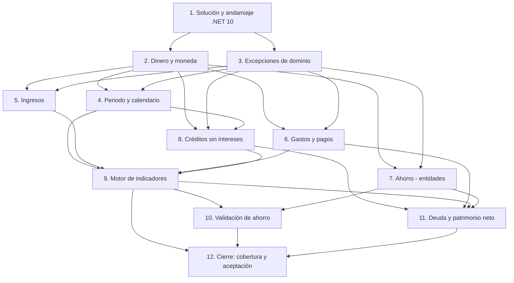

# Implementation Plan

Plan de implementación — Dominio y motor financiero

## Overview

Cada tarea es pequeña y verificable. El orden va de los cimientos (solución,
tipos de dinero) hacia el motor que los integra. Marca una tarea como completada
solo cuando su código compila y sus pruebas pasan. La verificación global de
cada bloque es `dotnet test` en verde con cobertura de Domain ≥ 90 %.

## Tasks

- [ ] 1. Preparar la solución y el andamiaje de .NET 10
  - Crear `global.json` fijando el SDK de .NET 10 y `Directory.Build.props`
    (Nullable enable, ImplicitUsings, TreatWarningsAsErrors, LangVersion latest).
  - Crear `MiSaldo.sln`, el proyecto `src/MiSaldo.Domain` (net10.0, sin paquetes
    de infraestructura) y `tests/MiSaldo.Domain.Tests` (xUnit, referencia a
    Domain), y agregarlos a la solución.
  - Verificar con `dotnet build` y un `dotnet test` con una prueba trivial en
    verde.
  - _Requisitos: R10.1_

- [ ] 2. Tipo de dinero y moneda (Common)
  - [ ] 2.1 Implementar `Currency` (código ISO + `DecimalPlaces`, con `Cop` y
        `Usd`) y `Money` (`decimal` + `Currency`) con normalización y redondeo
        bancario (`ToEven`) a los decimales de la moneda.
    - Pruebas: COP conserva 0 decimales, USD conserva 2; `Round` usa half-to-even.
    - _Requisitos: R1.1, R1.2_
  - [ ] 2.2 Implementar `Add`, `Subtract`, operadores y comparadores de `Money`,
        lanzando `CurrencyMismatchException` entre monedas distintas.
    - Pruebas: operar COP con USD lanza; sumar/restar misma moneda es correcto.
    - _Requisitos: R1.3, R10.2_
  - [ ] 2.3 Garantizar que acumular en `decimal` y redondear el total no pierde
        ni crea dinero (prueba de propiedad sobre varios montos).
    - _Requisitos: R1.4, R10.2_

- [ ] 3. Jerarquía de excepciones de dominio
  - Crear `DomainException` base y los subtipos: `NonPositiveAmountException`,
    `CurrencyMismatchException`, `PaymentExceedsBalanceException`,
    `WithdrawalExceedsSavingsException`, `SavingsExceedsAvailableException`,
    `InvalidPeriodRangeException`.
  - Pruebas: cada subtipo hereda de `DomainException` y conserva su mensaje.
  - _Requisitos: R10.2_

- [ ] 4. Periodo financiero y calendario
  - [ ] 4.1 Implementar `FinancialPeriod` (tipo, fechas inmutables, `Contains`,
        `StatusOn(today)` → Planned/Active/Overdue/Closed, `Close()`), rechazando
        rango inválido con `InvalidPeriodRangeException`.
    - Pruebas: los cuatro estados según la fecha de referencia; fin < inicio lanza.
    - _Requisitos: R2.1, R2.2, R2.3, R2.5_
  - [ ] 4.2 Implementar `PeriodSettings` y `PeriodCalendar.RangeFor` para semanal
        (RN-P01), quincenal (RN-P02, incluido A→B−1 / B→A−1) y mensual (RN-P03,
        día 1–28).
    - Pruebas: un caso por cada tipo, con los bordes de la regla quincenal.
    - _Requisitos: R2.4_
  - [ ] 4.3 Exponer el arrastre del periodo cerrado: positivo si está activo,
        cero si es negativo o el arrastre está inactivo.
    - Pruebas: saldo positivo con arrastre → arrastre; negativo → 0; inactivo → 0.
    - _Requisitos: R2.6 (CP-14)_

- [ ] 5. Ingresos
  - Implementar `IncomeTransaction` con estado Planned/Received, `MarkReceived`
    (fija la fecha de recepción) y validación de valor > 0.
  - Pruebas: valor ≤ 0 lanza; planificado no se marca recibido sin fecha; marcar
    recibido fija la fecha.
  - _Requisitos: R3.1, R3.2, R3.3, R3.4 (CP-13)_

- [ ] 6. Gastos y pagos
  - Implementar `ExpensePayment` (inmutable, valor > 0) y `Expense` con
    `TotalPaid`, `Outstanding` = max(0, presupuestado − pagado), `Status`
    derivado (Pending/Partial/Paid) y `AddPayment`.
  - Pruebas: estado según total pagado; sobrepago deja obligación en 0; valor ≤ 0
    lanza.
  - _Requisitos: R4.1, R4.2, R4.3, R4.4, R4.5_

- [ ] 7. Ahorro (entidades)
  - Implementar `SavingsTransaction` (inmutable, aporte/retiro, objetivo opcional)
    y `SavingsGoal` con `CurrentBalance` (Σaportes − Σretiros) y
    `ProgressPercent`.
  - Pruebas: balance y porcentaje de progreso correctos; aporte y retiro con y sin
    objetivo.
  - _Requisitos: R6.1, R6.4, R6.5_

- [ ] 8. Créditos sin intereses
  - [ ] 8.1 Implementar `Credit` con generación de calendario: financiado =
        Original − Down repartido en N cuotas, la última absorbe el residuo;
        `OutstandingBalance` = Original − Down − Σpagos.
    - Pruebas: CP-04 (1.500.000 → 3×500.000) y CP-15 (1.000.000 →
      333.333/333.333/333.334, suma exacta).
    - _Requisitos: R7.1, R7.2, R7.3, R7.11_
  - [ ] 8.2 Implementar `RegisterPayment`: acepta pago positivo ≤ saldo, lo aplica
        a la primera cuota abierta y reparte el saldo restante en partes iguales
        entre las cuotas abiertas (la última absorbe el residuo), sin tocar pagos
        previos.
    - Pruebas: CP-05 (abono 600.000 → saldo 900.000, cuotas 450.000) y CP-06
      (abono 400.000 → saldo 1.100.000, cuotas 550.000).
    - _Requisitos: R7.4, R7.5, R7.6, R7.10_
  - [ ] 8.3 Reglas de cierre y borde: saldo 0 → *Paid* y cuotas abiertas
        canceladas; pago parcial no marca pagado; pago > saldo lanza; faltante en
        última cuota agrega una cuota extra un periodo después.
    - Pruebas: un caso por cada regla, incluida la cuota extra (RN-C04).
    - _Requisitos: R7.7, R7.8, R7.9, R7.10_

- [ ] 9. Motor de indicadores del periodo
  - [ ] 9.1 Implementar `PeriodIndicators`, `EngineInput` y
        `FinancialEngine.Compute`: ingreso recibido, gasto pagado (incluye cuotas
        de crédito), obligaciones, caja, reservado, dinero libre y consumo de
        presupuesto (0 si el denominador es 0). Filtra cada movimiento por su
        fecha contra el rango del periodo.
    - Pruebas: CP-01, CP-02, CP-03, CP-10, CP-13.
    - _Requisitos: R5.1–R5.9, R3.4_
  - [ ] 9.2 Verificar que el pago de crédito se cuenta una sola vez dentro del
        gasto pagado y se expone en `CreditPayments` solo para trazabilidad.
    - Pruebas: CP-17 (pago de cuota 500.000 → caja 1.500.000, gasto pagado
      500.000, aparece como pago de crédito).
    - _Requisitos: R8.1, R8.2, R8.3_

- [ ] 10. Validación de ahorro contra el disponible del periodo
  - Implementar el servicio que valida un movimiento de ahorro usando los
    indicadores del periodo: aporte ≤ disponible (rechaza si excede), retiro ≤
    saldo del objetivo/ahorro general.
  - Pruebas: CP-18 (aporte 300.000 con disponible 200.000 → rechazado), CP-19
    (aporte 200.000 con disponible 200.000 → aceptado, no aparece en gastos),
    retiro mayor al saldo → rechazado.
  - _Requisitos: R6.2, R6.3, R10.2_

- [ ] 11. Deuda pendiente y patrimonio neto
  - Implementar `FinancialEngine.PendingDebt` (créditos activos + obligaciones
    vencidas no pagadas; las futuras no cuentan) y `FinancialEngine.NetWorth`
    (caja acumulada + ahorro acumulado − deuda).
  - Pruebas: obligación futura no suma a deuda; obligación vencida sí; patrimonio
    con los tres términos.
  - _Requisitos: R9.1, R9.2_

- [ ] 12. Cierre: cobertura y suite de aceptación
  - Ejecutar `dotnet test --collect:"XPlat Code Coverage"` y confirmar cobertura
    de Domain ≥ 90 %; cerrar huecos con pruebas puntuales.
  - Verificar que existen y pasan como pruebas nombradas los casos CP-01 a CP-06,
    CP-10, CP-13, CP-15, CP-17, CP-18 y CP-19.
  - _Requisitos: R10.3, R10.4, R10.5_

## Task Dependency Graph

## Notes

- Cada tarea se marca como completada solo cuando su código compila y sus pruebas
  pasan; la verificación de cada bloque es `dotnet test` en verde con cobertura de
  Domain ≥ 90 %.
- Las tareas 1 a 3 forman los cimientos (solución, dinero/moneda, excepciones) y
  habilitan al resto; las tareas 5 a 8 pueden abordarse en paralelo una vez
  disponibles el tipo de dinero y las excepciones.
- El motor de indicadores (tarea 9) integra ingresos, gastos y créditos, y es
  prerrequisito de la validación de ahorro (10), la deuda/patrimonio (11) y el
  cierre (12).
- Los casos de prueba (CP-xx) y las reglas de negocio (RN-xx) referenciados
  provienen del documento de diseño y requisitos de esta especificación.
