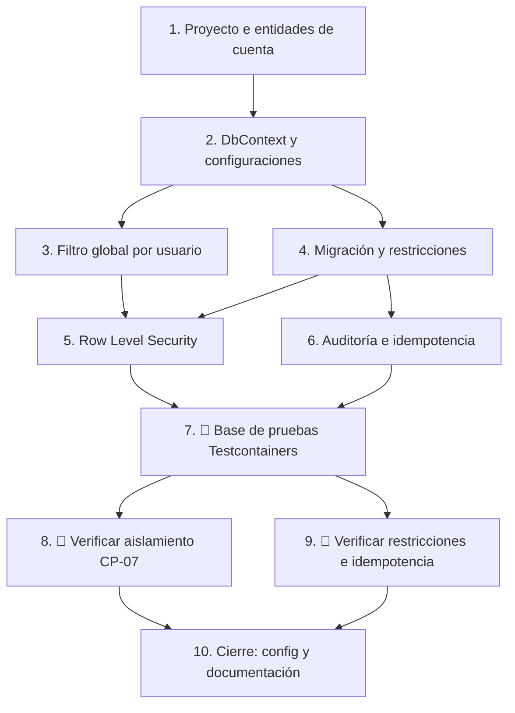

# Implementation Plan

> Persistencia e aislamiento por usuario de MiSaldo.

## Overview

Este plan construye la capa de persistencia en orden: primero el andamiaje y el
modelo (tareas 1–2), luego las dos barreras de aislamiento y las garantías de la
base (tareas 3–6), y al final la verificación contra PostgreSQL real (tareas
7–9) y el cierre (tarea 10).

Cada tarea es pequeña y verificable. Marca una tarea como completada solo cuando
compila y sus pruebas pasan. Las tareas marcadas con 🐳 necesitan **Docker
corriendo** (Testcontainers levanta PostgreSQL); el resto se verifica con
compilación y pruebas sin base de datos.

## Tasks

- [x] 1. Proyecto de infraestructura y entidades de cuenta
  - Crear `src/MiSaldo.Infrastructure` (net10.0) con EF Core y Npgsql, referencia
    a `MiSaldo.Domain`, y agregarlo a la solución.
  - Definir las entidades de cuenta de F1 que el dominio aún no tiene (`User`,
    `UserProfile`, `UserSettings`, `ConsentRecord`, `AccountDeletionRecord`),
    decidiendo dominio vs. infraestructura según tengan reglas o no.
  - Verificar con `dotnet build`.
  - _Requisitos: R1.1, R2.3_

- [x] 2. DbContext y configuraciones de entidad
  - [x] 2.1 Implementar `MiSaldoDbContext` con los `DbSet` de F1 y `ICurrentUser`.
    - _Requisitos: R1.2_
  - [x] 2.2 Implementar `MoneyConverter` y una `IEntityTypeConfiguration<T>` por
        entidad: tipos `numeric(18,2)`, `date`, `timestamptz`; campos base
        (`Id`, `UserId`, `CreatedAt`, `UpdatedAt`); mapeo de `Expense` con su
        colección de pagos por campo de respaldo.
    - Pruebas: el modelo se construye sin errores (validación con `context.Model`).
    - _Requisitos: R1.3, R1.4, R2.1, R2.2_

- [x] 3. Filtro global por usuario (barrera 1)
  - Aplicar `HasQueryFilter` por `UserId` a toda entidad financiera y asignar
    `UserId` desde `ICurrentUser` al crear; fallar seguro si no hay usuario.
  - Pruebas (sin base, con proveedor en memoria de EF Core): una consulta solo
    devuelve entidades del usuario actual; crear asigna el `UserId` correcto.
  - _Requisitos: R3.1, R3.2, R3.3, R3.4_

- [x] 4. Migración inicial y restricciones de integridad
  - [x] 4.1 Generar la migración inicial con todas las tablas de F1, llaves
        foráneas, `CHECK` de montos, token de concurrencia (`xmin`) e índices
        por `UserId`.
    - _Requisitos: R5.1, R5.2, R6.1, R6.3_
  - [x] 4.2 Agregar al esquema el EXCLUDE de no solapamiento de periodos por
        usuario, el índice único de categorías por usuario sin mayúsculas y el
        `CHECK` de fin ≥ inicio de periodo.
    - _Requisitos: R5.3, R5.4, R5.5_

- [x] 5. Row Level Security (barrera 2)
  - Migración SQL que habilita RLS y crea la política por `UserId` de sesión en
    cada tabla financiera; `RlsConnectionInterceptor` que ejecuta
    `SET app.user_id` por unidad de trabajo; rol de app sin `BYPASSRLS`.
  - _Requisitos: R4.1, R4.2_

- [ ] 6. Auditoría e idempotencia
  - [ ] 6.1 `AuditingInterceptor`: llena `CreatedAt`/`UpdatedAt` y escribe
        `AuditLog` (quién, cuándo, antes/después) en cada cambio de movimiento.
    - _Requisitos: R6.2_
  - [ ] 6.2 Idempotencia de pagos: `IdempotencyKey` con índice único por
        (usuario, clave); inserción del pago en transacción.
    - _Requisitos: R7.1, R7.3_

- [ ] 7. 🐳 Base de pruebas de integración con Testcontainers
  - Crear `tests/MiSaldo.Infrastructure.Tests` con `Testcontainers.PostgreSql`;
    fixture que levanta PostgreSQL, aplica migraciones y expone una fábrica de
    `DbContext` con un `ICurrentUser` controlable.
  - Verificar con una prueba de humo: insertar y leer una entidad.
  - _Requisitos: R9.1, R9.3_

- [ ] 8. 🐳 Verificar el aislamiento (CP-07)
  - Pruebas: con datos de A y B, y la sesión fijada a A, una consulta normal y
    una consulta cruda (que ignore el filtro de EF Core) NO ven datos de B; la
    RLS lo impide.
  - _Requisitos: R4.3, R4.4_

- [ ] 9. 🐳 Verificar restricciones, idempotencia y multi-dispositivo
  - Pruebas: periodos solapados del mismo usuario rechazados (RF-PRD-03);
    categoría duplicada por usuario rechazada (RF-CAT-04); fin < inicio
    rechazado; mismo pago con la misma clave de idempotencia → una sola fila
    (CP-12); dos contextos sobre la misma base ven los mismos datos (CP-16);
    concurrencia optimista falla de forma controlada.
  - _Requisitos: R5.3, R5.4, R5.5, R6.1, R7.2, R8.1, R8.2_

- [ ] 10. Cierre: configuración, secretos y documentación
  - Añadir `.env.example` (sin valores reales), documentar cómo correr las
    pruebas (requiere Docker) y actualizar el README/hoja de ruta.
  - Verificar la suite completa: dominio + infraestructura en verde.
  - _Requisitos: R9.2, RNF-SEG-08_

## Task Dependency Graph

## Notes

- **Orden de verificación:** las tareas 1–6 se compilan y prueban sin base de
  datos (el modelo de EF Core se valida con `context.Model` y el filtro global
  con el proveedor en memoria). Solo las tareas 7–9 requieren Docker, porque RLS
  y las restricciones de PostgreSQL no existen en proveedores en memoria.
- **Dos barreras de aislamiento:** la tarea 3 es la primera barrera (filtro de EF
  Core) y la tarea 5 la segunda (RLS en la base). CP-07 (tarea 8) verifica que la
  segunda barrera protege aun si la primera se omitiera.
- **Versiones de EF Core:** todos los paquetes de EF Core quedan alineados en
  10.0.4 para coincidir con la dependencia de Npgsql 10.0.3 y evitar conflictos
  de carga en tiempo de ejecución.
- **Secretos:** la cadena de conexión viene de variables de entorno / Secrets
  Manager; nunca se commitea (RNF-SEG-08). La tarea 10 añade `.env.example` sin
  valores reales.
- **Saldos:** no se persisten; se recuperan los movimientos y el motor del
  dominio los calcula (RNF-DAT-07).
